

# RichMeet

**Live translation of your calls, plus summaries and tasks for every meeting — in one app, on your Mac, with no bot in the call.**

<a class="rm-store" href="{{ site.appstore_url }}">Download on the Mac App Store</a>Coming soon to the Mac App Store

*[Русская версия ниже](#по-русски)*

- **Live translation with no minute limits.** Free, in every language your Mac supports, with Auto mode for two-language calls.
- **Your names and terms, spelled right.** A glossary guides speech recognition, translation and summaries.
- **One app instead of three.** Translation, meeting minutes and an organizer. Audio is processed on your Mac — nothing joins the meeting.

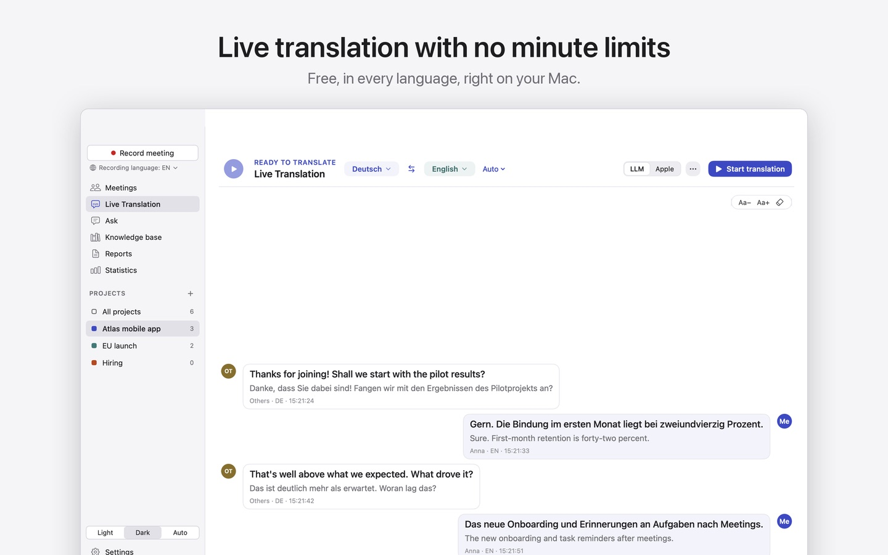
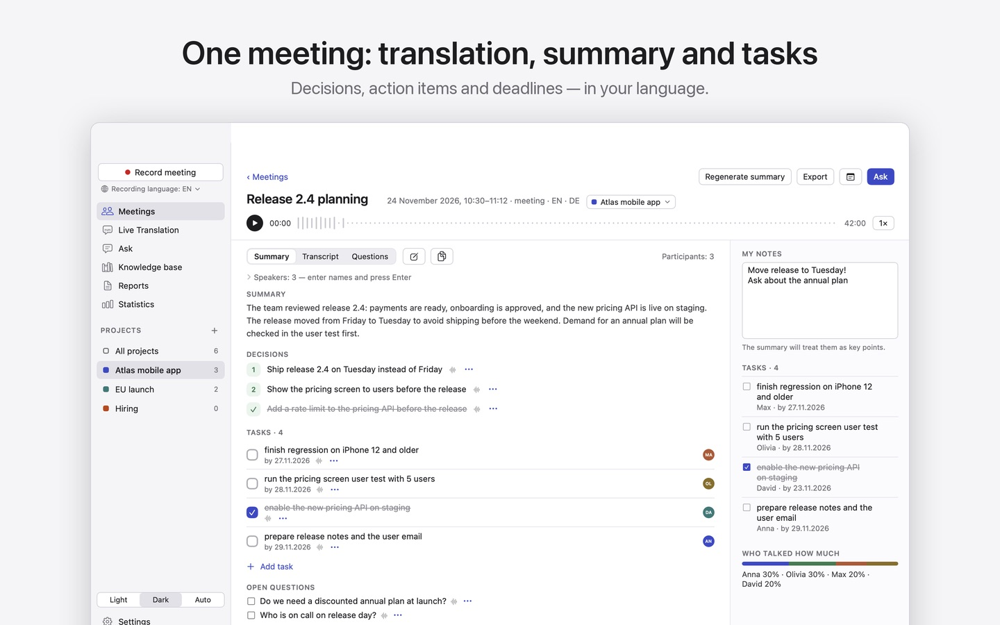
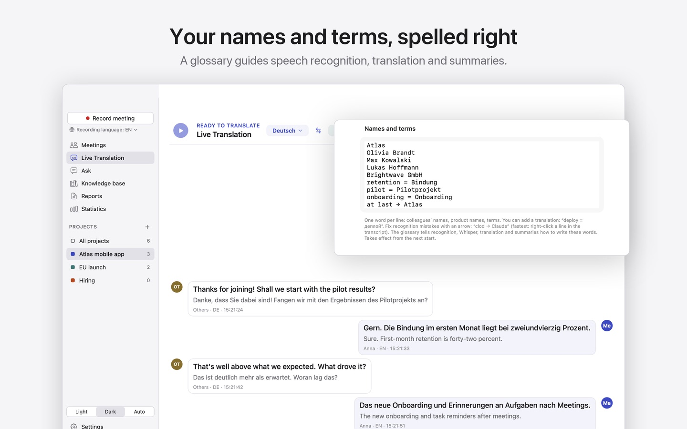

## Glossary for names and terms
Mistakes in names, company names and jargon are the most common complaint about meeting transcripts. In RichMeet you list them once:

- names and terms are passed to speech recognition and to Whisper as hints;
- with a translation (`retention = Bindung`) the AI model uses your translation of the term;
- with an arrow (`at last → Atlas`) a word that recognition mishears is fixed automatically in live transcripts — or right-click a line to fix it in a past meeting;
- summaries, reports and answers keep your spelling.

Up to 20 terms in the free version, unlimited in Pro.

## Private by design
Speech recognition (Apple, on device), translation (Apple Translate or the built-in model) and summaries run on your Mac. No account, no analytics, no recordings sent anywhere. RichMeet listens to your Mac's audio, so it works the same with any call app or video, and nobody is added to the call. Cloud models (Claude, OpenAI, DeepSeek, Kimi) are optional and used only with your own API key.

## An organizer on top of your meetings
- Summary with decisions, tasks, owners and deadlines.
- Tasks across all meetings, overdue ones highlighted; daily, weekly and monthly reports.
- Ask questions about all your meetings and your own documents — answers link to the source.
- Calendar, projects, search, notes, export to PDF, Word and Markdown.
- Access for AI assistants (MCP): Claude and other assistants can read your meetings locally, read-only.

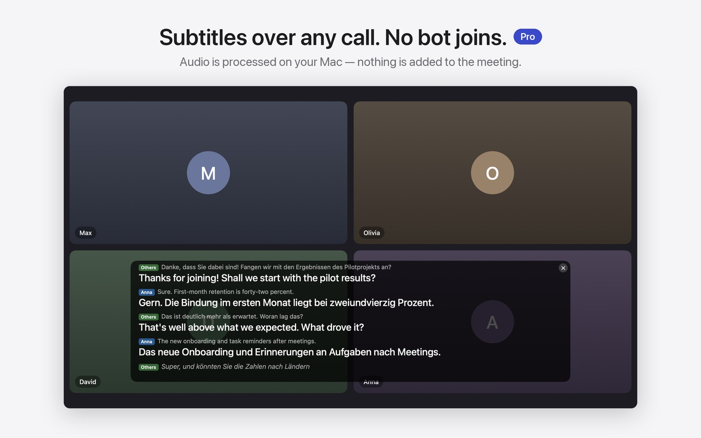
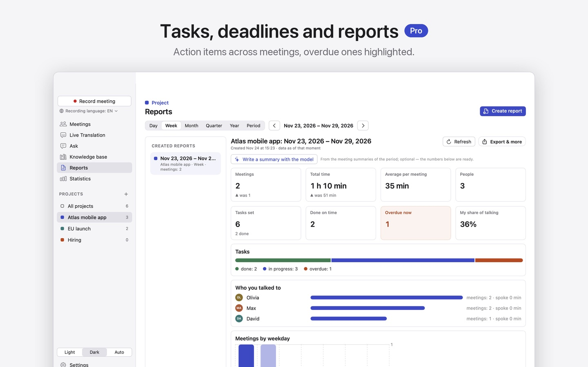
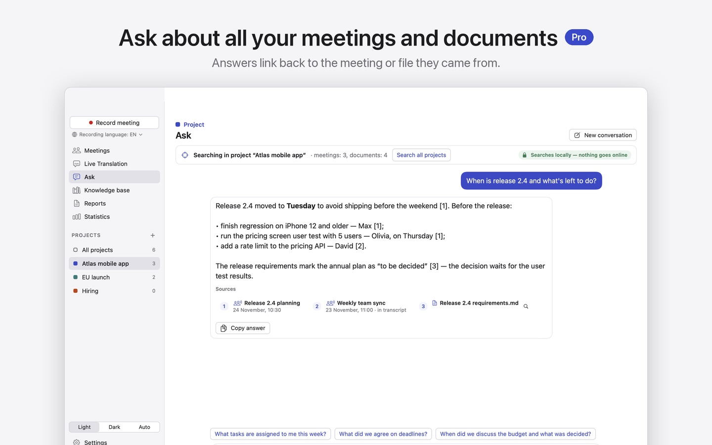
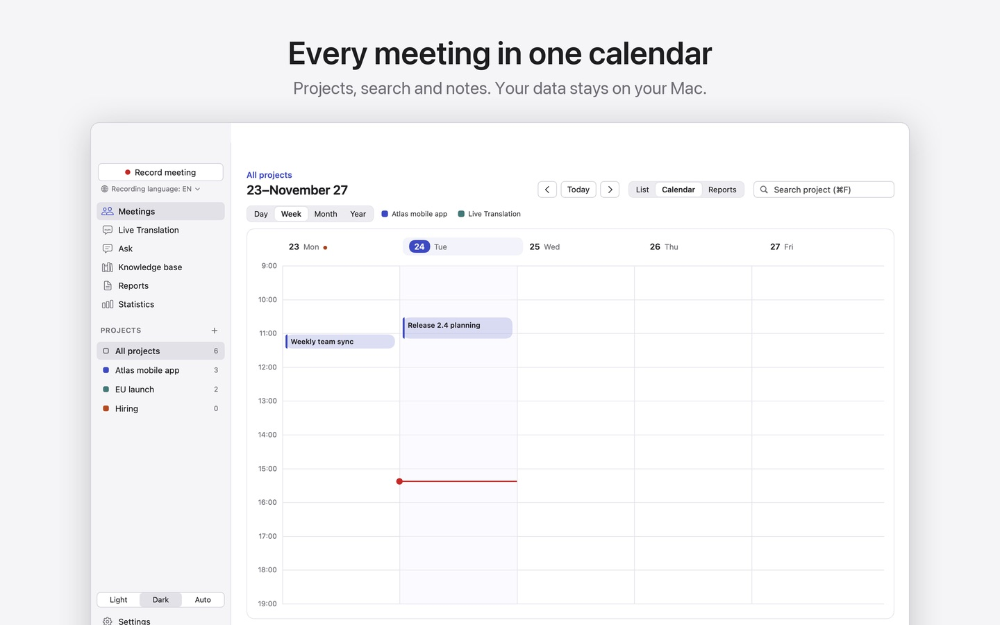

## How it compares
By category of product, as they usually work (individual products differ).

<table class="rm-cmp">
<tr><th></th><th>RichMeet</th><th>Cloud meeting note-takers</th><th>Live subtitle translators</th><th>Local transcription apps</th></tr>
<tr><td>Live translation during the call</td><td>✓</td><td>rarely</td><td>✓</td><td>—</td></tr>
<tr><td>Summary, tasks and deadlines</td><td>✓</td><td>✓</td><td>—</td><td>sometimes</td></tr>
<tr><td>Organizer: tasks across meetings, reports</td><td>✓</td><td>partly, on higher plans</td><td>—</td><td>—</td></tr>
<tr><td>Processing on your Mac</td><td>✓</td><td>—</td><td>varies</td><td>✓</td></tr>
<tr><td>No bot joins the call</td><td>✓</td><td>often a bot</td><td>✓</td><td>✓</td></tr>
<tr><td>Free tier without minute limits</td><td>✓ live translation</td><td>monthly minutes</td><td>usually minutes</td><td>varies</td></tr>
<tr><td>Glossary of names and terms</td><td>✓</td><td>some</td><td>some</td><td>some</td></tr>
</table>

## Free and Pro

| | Free | Pro |
|---|:---:|:---:|
| Live translation in the app window — all languages, no limits | ✓ | ✓ |
| Meeting recording and transcription | last 3 meetings visible | full archive |
| Meeting summary | brief | decisions, tasks, deadlines |
| Calendar and search | ✓ | ✓ |
| Glossary of names and terms | up to 20 | unlimited |
| Floating subtitles over any call or video | | ✓ |
| Tasks across meetings, reports for a day / week / month | | ✓ |
| Ask across all meetings, knowledge base from your documents | | ✓ |
| Export (PDF, Word, Markdown, email) | | ✓ |
| Access for AI assistants (MCP) | | ✓ |
| Whisper cross-check of live transcription | | ✓ |
| Model choice: Gemma E4B, LM Studio, cloud with your key | | ✓ |
| Automatic call recording, custom hotkeys, statistics | | ✓ |

**Pro:** 14 days free, then **$59.99 once** (Pro for life) or **$4.99 / month** or **$39.99 / year**. Older meetings above the free limit are kept, not deleted, and open again with Pro. Prices may vary by country; the App Store shows the final price. Subscriptions renew automatically until cancelled in your App Store account settings.

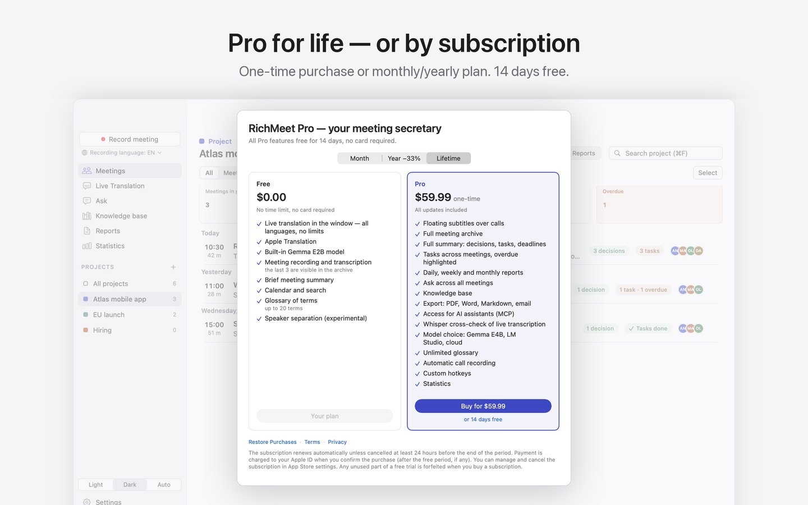

## Requirements
Mac with Apple silicon (M1 or later), macOS 26 or later. Models for translation and summaries are downloaded on first use (about 3 GB).

## Documents
[Privacy policy](PRIVACY) · [Terms of use](EULA) · [Third-party components](THIRD_PARTY_NOTICES)

---

## По-русски

**Живой перевод созвонов, а после — конспект и задачи по каждой встрече. В одном приложении, на вашем Mac, без бота в звонке.**

<a class="rm-store" href="{{ site.appstore_url }}">Загрузить в Mac App Store</a>Скоро в Mac App Store

- **Живой перевод без лимита минут.** Бесплатно, на всех языках, которые поддерживает ваш Mac, режим «Авто» для разговора на двух языках.
- **Имена и термины без ошибок.** Словарь подсказывает распознаванию, переводу и конспекту.
- **Одно приложение вместо трёх.** Перевод, конспект и органайзер. Звук обрабатывается на Mac — во встречу никто не добавляется.

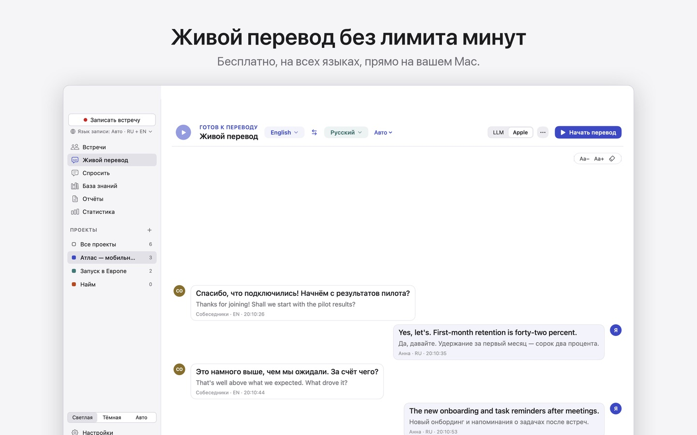
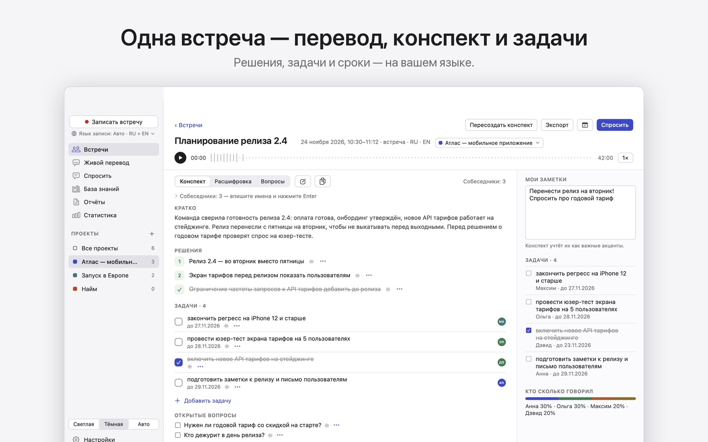
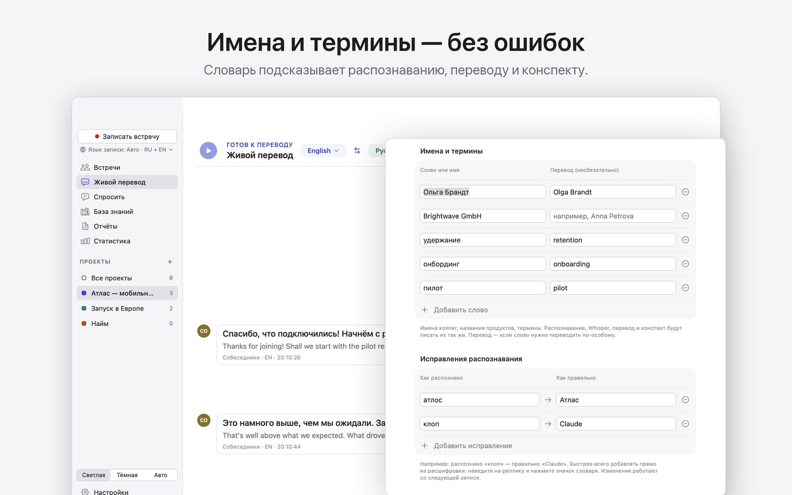

### Словарь имён и терминов
Ошибки в именах, названиях компаний и терминах — самая частая жалоба на расшифровки встреч. В RichMeet их достаточно перечислить один раз:

- имена и термины передаются подсказками распознаванию речи и Whisper;
- с переводом («удержание = retention») модель переводит термин так, как вы указали;
- со стрелкой («атлос → Атлас») слово, которое распознавание слышит неправильно, исправляется в живой расшифровке автоматически, а в прошлой встрече — правой кнопкой по реплике;
- конспекты, отчёты и ответы сохраняют ваше написание.

До 20 терминов бесплатно, в Pro — без ограничений.

### Приватность
Распознавание речи (Apple, на устройстве), перевод (переводчик Apple или встроенная модель) и конспекты работают на вашем Mac. Без учётной записи, без аналитики, записи никуда не отправляются. RichMeet слушает звук Mac, поэтому одинаково работает с любым приложением для созвонов и с видео, и в звонок никто не добавляется. Облачные модели (Claude, OpenAI, DeepSeek, Kimi) — по желанию и только с вашим API-ключом.

### Органайзер поверх встреч
- Конспект: решения, задачи, исполнители и сроки.
- Сквозные задачи по всем встречам, просроченные подсвечены; отчёты за день, неделю и месяц.
- Вопросы по всем встречам и вашим документам — со ссылками на источник.
- Календарь, проекты, поиск, заметки, экспорт в PDF, Word и Markdown.
- Доступ для ИИ-помощников (MCP): Claude и другие помощники читают ваши встречи локально, только чтение.

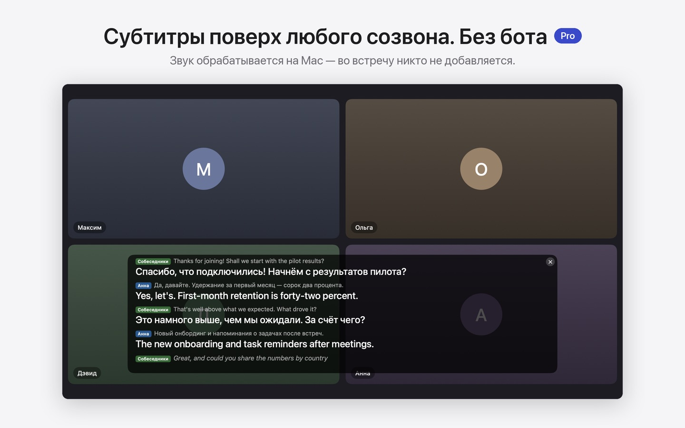
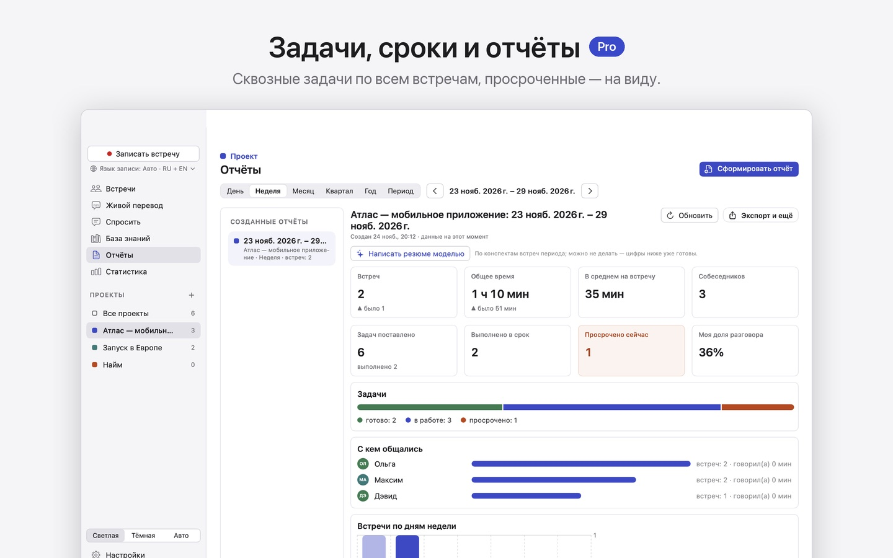
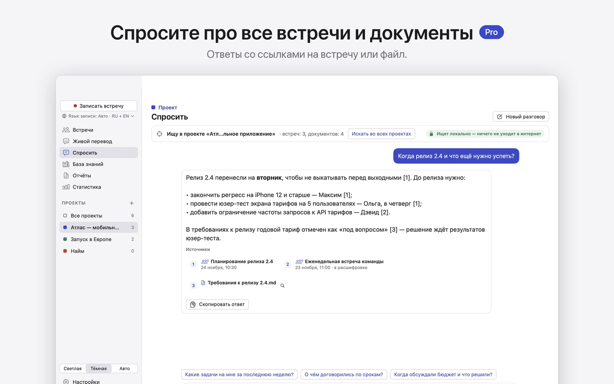
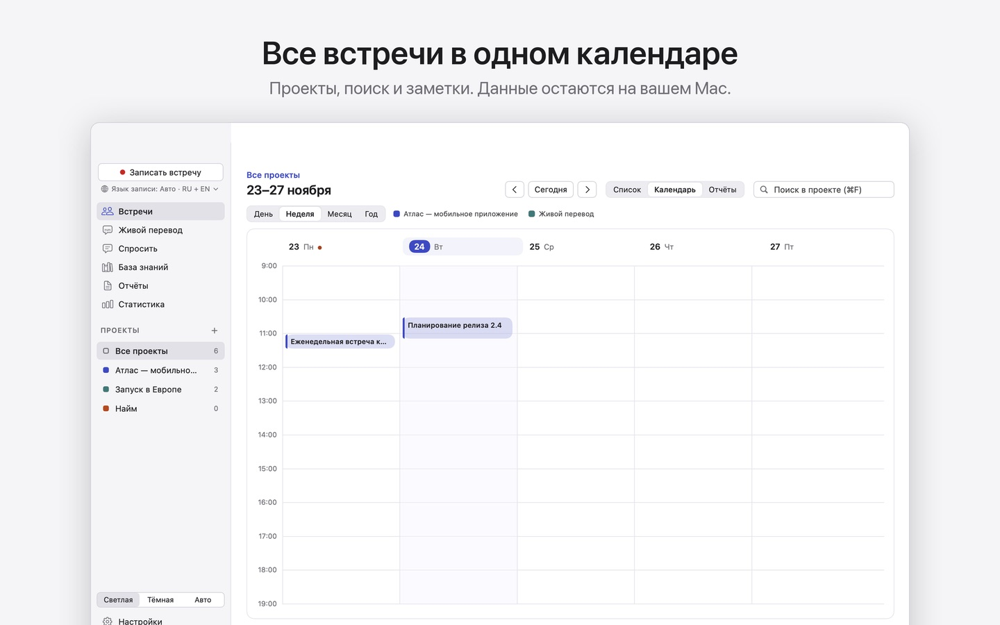

### Сравнение
По категориям продуктов, как они обычно устроены (отдельные продукты отличаются).

<table class="rm-cmp">
<tr><th></th><th>RichMeet</th><th>Облачные сервисы заметок</th><th>Переводчики-субтитры</th><th>Локальные расшифровщики</th></tr>
<tr><td>Живой перевод во время звонка</td><td>✓</td><td>редко</td><td>✓</td><td>—</td></tr>
<tr><td>Конспект, задачи и сроки</td><td>✓</td><td>✓</td><td>—</td><td>иногда</td></tr>
<tr><td>Органайзер: сквозные задачи, отчёты</td><td>✓</td><td>частично, на дорогих тарифах</td><td>—</td><td>—</td></tr>
<tr><td>Обработка на вашем Mac</td><td>✓</td><td>—</td><td>по-разному</td><td>✓</td></tr>
<tr><td>Без бота в звонке</td><td>✓</td><td>часто бот</td><td>✓</td><td>✓</td></tr>
<tr><td>Бесплатно без лимита минут</td><td>✓ живой перевод</td><td>минуты в месяц</td><td>обычно минуты</td><td>по-разному</td></tr>
<tr><td>Словарь имён и терминов</td><td>✓</td><td>у некоторых</td><td>у некоторых</td><td>у некоторых</td></tr>
</table>

### Бесплатно и Pro

| | Бесплатно | Pro |
|---|:---:|:---:|
| Живой перевод в окне — все языки, без ограничений | ✓ | ✓ |
| Запись и расшифровка встреч | видны последние 3 | весь архив |
| Конспект встречи | краткий итог | решения, задачи, сроки |
| Календарь и поиск | ✓ | ✓ |
| Словарь имён и терминов | до 20 | без ограничений |
| Плавающие субтитры поверх любого созвона и видео | | ✓ |
| Сквозные задачи, отчёты за день / неделю / месяц | | ✓ |
| «Спросить» по всем встречам, база знаний из документов | | ✓ |
| Экспорт (PDF, Word, Markdown, почта) | | ✓ |
| Доступ для ИИ-помощников (MCP) | | ✓ |
| Сверка Whisper с живым распознаванием | | ✓ |
| Выбор модели: Gemma E4B, LM Studio, облако по вашему ключу | | ✓ |
| Автозапись звонков, свои горячие клавиши, статистика | | ✓ |

**Pro:** 14 дней бесплатно, затем **$59.99 один раз** (Pro навсегда), **$4.99 в месяц** или **$39.99 в год**. Встречи сверх бесплатного лимита не удаляются и снова открываются с Pro. Цены в разных странах могут отличаться, окончательную цену показывает App Store. Подписка продлевается автоматически, пока её не отменят в настройках учётной записи App Store.

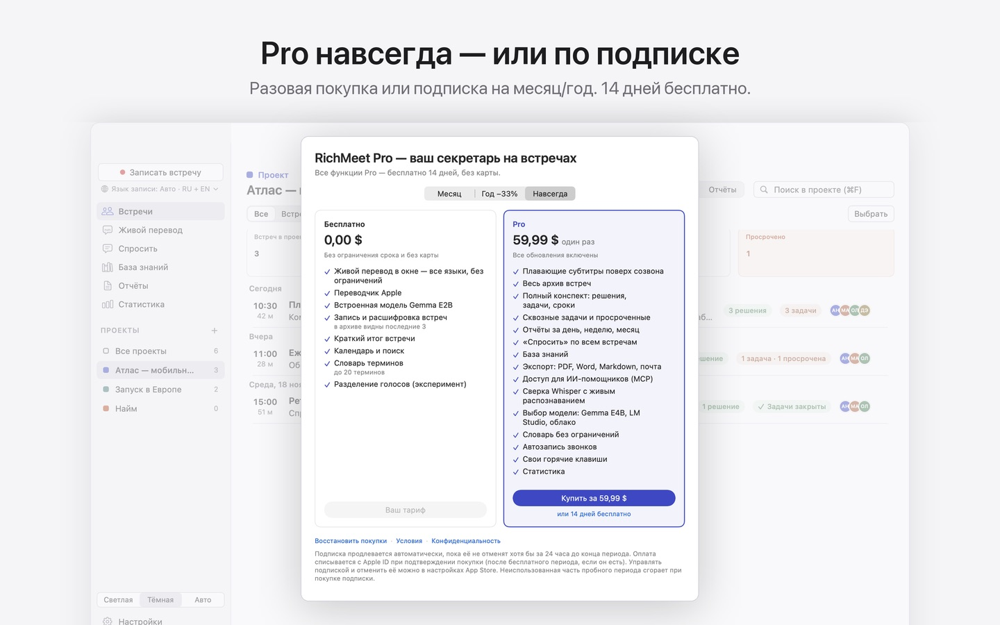

### Требования
Mac на Apple silicon (M1 и новее), macOS 26 или новее. Модели для перевода и конспектов скачиваются при первом использовании (около 3 ГБ).

### Документы
[Конфиденциальность](PRIVACY) · [Условия использования](EULA) · [Сторонние компоненты](THIRD_PARTY_NOTICES)
